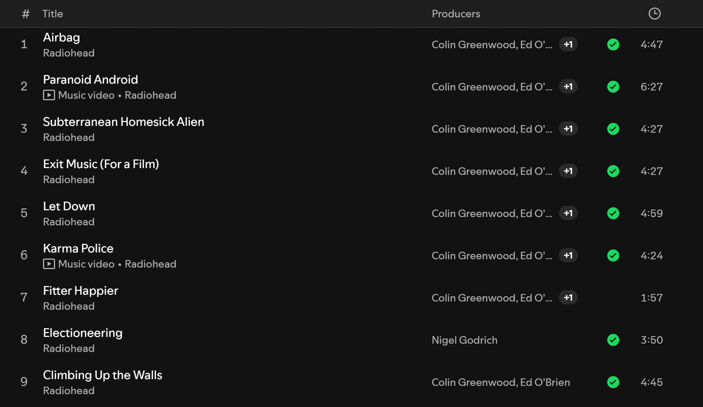
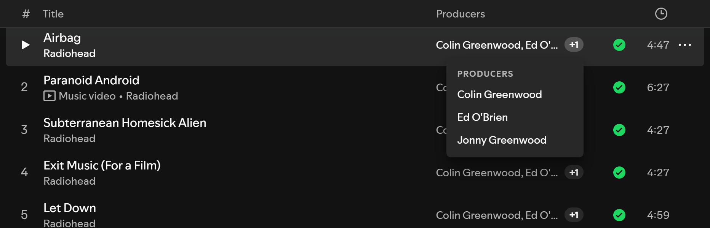
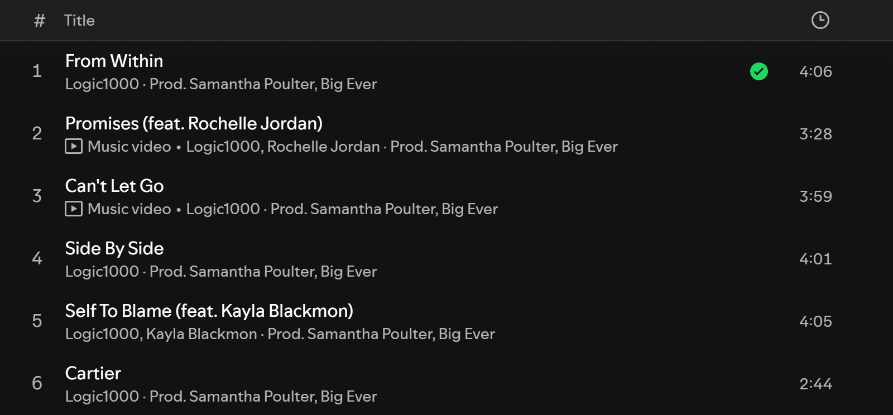

# Producers

<!-- site:skip-start -->
**Documentation:** https://spicetify.yusufaf.dev/producers/
<!-- site:skip-end -->

A [Spicetify](https://spicetify.app/) extension that shows who produced each track, right in the tracklist on album and playlist pages. The data comes from Spotify's own credits, so there's no API key or account to set up.



## Why

Spotify knows who produced a song: right-click a track and choose **View credits**. But it only tells you one track at a time, and only when you ask. If you want to know who's behind the beats on an album, or you like a song and want to find more by the person who made it, that's a lot of right-clicking. This extension puts the producers next to every track, so you can scan a whole album at a glance and click straight through to a producer's artist page.

## Features

- A **Producers** column on album and playlist pages, next to Spotify's own columns.
- Up to two names per track, then a **+N** chip. Hover it (or focus it and press Enter) for the full list, grouped by role.
- Names link to the producer's Spotify artist page when they have one. Names without a page are plain text.
- Counts **Producer**, **Studio Producer** and **Co-Producer** credits. Executive, vocal and additional producers are left out.
- On narrow windows, where Spotify hides its own columns, the producers move to the grey line under the track title instead (`Artist · Prod. Name`). Producers who are already the track's artist are skipped there, since the space is small.
- Turn it on or off per page type from Spotify's own **Columns** menu (the **List** button above the tracklist), or from the profile menu.
- Credits load only for the rows on screen, a few at a time, and are cached for 30 days, so even a 2,000-song playlist doesn't flood Spotify with requests.

| Full list on hover | Narrow window |
| --- | --- |
|  |  |

## Install

Requires [Spicetify](https://spicetify.app/docs/getting-started), installed and applied at least once. The Marketplace route also needs the [Spicetify Marketplace](https://spicetify.app/docs/customization/marketplace) custom app.

### From Spicetify Marketplace

1. In Spotify, open **Marketplace** (the shopping-cart icon at the top left) and stay on the **Extensions** tab.
2. Search for `Producers`. If it doesn't show up, click **Load more** (» at the bottom of the list) until it does. Marketplace loads extensions in batches and only searches the ones it has loaded.
3. Hover the **Producers** card, click its download button, then click **Reload now**.

### Manually

1. Download [`producers.js`](https://raw.githubusercontent.com/yusufaf/spicetify-producers/main/producers.js) (right-click → **Save link as…**) into your Spicetify `Extensions` folder:
   - Windows: `%APPDATA%\spicetify\Extensions`
   - macOS / Linux: `~/.config/spicetify/Extensions`
2. Enable it and apply:

   ```bash
   spicetify config extensions producers.js
   spicetify apply
   ```

## Settings

There are two switches, **Show on album pages** and **Show on playlist pages**, both on by default. You can flip them in either place:

- **Columns menu:** click **List** above any album or playlist tracklist. **Producers** sits under **Columns** next to Spotify's own entries and switches the page type you're on.
- **Profile menu:** click your avatar (top right) and choose **Producers**.

## Good to know

- **"—" means Spotify has no producer credit for that track.** That's common for solo electronic and ambient artists, whose credits often list only the artist and the composer. In a sample of 40 tracks, 58% had a producer credit.
- **"?" means the credits couldn't be loaded**, for example during a network drop. It retries on its own once requests start working again. Hover any "—" or "?" for a short explanation.
- **Credits are Spotify's.** If a name is missing or wrong, it's missing or wrong in **View credits** too.
- **Spotify in another language:** Spotify sends role names as display text. The extension matches the English names, so it may show "—" everywhere if Spotify's language isn't English. Please [open an issue](https://github.com/yusufaf/spicetify-producers/issues) if that happens to you.
- Tested on Spotify 1.3.3 with Spicetify 2.45.

## How it works

When you open an album or playlist, the extension loads its track list once (`getAlbum` for albums, `PlaylistAPI.getContents` for playlists) and matches each row on screen to a track by its title and duration. That's because Spotify's tracklist rows don't expose a track ID. For each matched row it asks Spotify for the track's credits using the same GraphQL query the **View credits** dialog uses (`queryTrackCreditsGroupedModal`), and keeps the producer roles.

Requests run four at a time and at most 120 a minute. If Spotify starts refusing them, the whole queue backs off and retries later. Rows that scroll away before their turn are skipped. Results, including "no producers", are cached in `Spicetify.LocalStorage` for 30 days.

The column itself is added by extending Spotify's grid template with a `[producers]` track before the duration, so it lines up with Spotify's header and its own columns.

## License

MIT — see [LICENSE](LICENSE).
